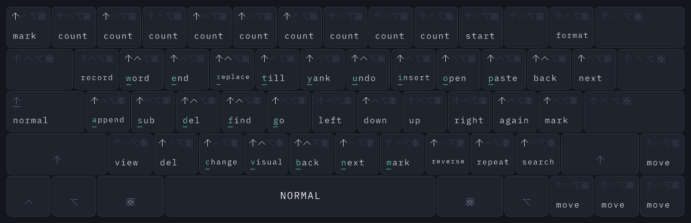
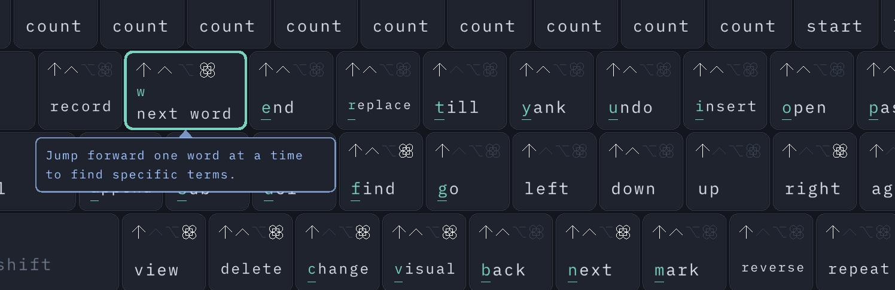

# KeyGuide

KeyGuide is a small passive shortcut overlay for Zed, default Neovim in
Ghostty, and Blender's default mesh-modeling keymap, adapted from elf222's game using C++20, [raylib](https://www.raylib.com/), the same ECS Registry, and the
same ICommand/CommandRegistry pipeline. KeyGuide adds one-sentence [AI tips](#ai-tips) from
open-weight models (local Ollama or DigitalOcean Inference), checked so they never invent a
shortcut, and reads your real [AeroSpace config](#keybinding-files).

On macOS the keyboard floats above ordinary windows, passes mouse clicks through,
and observes global input while Zed, Ghostty or Blender is focused, using a listen-only event tap. It never changes,
blocks, remaps, consumes, delays, or posts keyboard events. Zed and Neovim modes are
**assumed or inferred**. Blender can report its real mode and running tools through
an optional read-only add-on that you install and enable. No screen capture is used.
Keys stay visible as outlines; relevant hints and exact modifier availability
change with the tracked state. The window fits the resting keyboard: **748 × 243
logical pixels**, including an 8-pixel margin. Space shows the mode and a small
pending sequence, for example `NORMAL  d2` or `NORMAL  Ctrl-w`. It zooms and moves
with the keyboard. Mode/status labels, including RESYNC, are white; inactive
status stays gray. Hover zooms around the pointer, reveals the chord and full hint, and
widens the hovered key; longer hints wrap inside that key.
While the pointer is anywhere inside the overlay, the displayed app/mode, pending
state and hint descriptions stay on the last shown state. Tracking continues in
the background; leaving the window immediately shows the latest state. Pressed
keys and modifier feedback stay live, and holding a modifier still reveals its
hints in the frozen mode. This also covers the window's gaps and margins.

Hover hitboxes always use the original unzoomed positions and sizes, so expanded
keys cannot capture a neighboring key's original area or the gaps between keys.
Hints use only the currently held modifier combination: in Insert, `u` has no
command label until Control is held. Icons advertise combinations compatible with
the modifiers already held; incompatible icons dim. Enlarged edge keys stay inside
the keyboard area, and modifier icons fit even the narrow keys. Modifier keys
show their own symbol without repeating the four availability slots.
Available modifier icons are white; held compatible modifiers and enabled Caps Lock
are green. Orange is no longer drawn by the keyboard UI (`WARNING` remains an unused palette constant).

Every row spans 15 units. Backtick has the same 1-unit width as number keys;
bottom-row Control and both Option keys are also 1 unit. The top row starts with backtick.
Escape's hints and pressed highlight live on the
Caps/Esc key, alongside the Caps Lock symbol, matching the external short-Caps
remap. Up is to the right of right Shift, above the bottom arrow row. This presentation does not remap input:
physical Escape still drives tracking, while ordinary Caps Lock only updates Caps state.

Space also shows **INACTIVE**, **RESYNC**, **PAUSED**, or **INPUT OFF** when
applicable. The top of the **KeyGuide** menu shows the
current app/mode line and its detail lines. Hovering Space shows no textbox.
There is no header/footer. **RESYNC hides all command hints and availability markers**,
including Escape/Ctrl-[; only pressed-key/modifier feedback remains. Vim recovery
uses two Escape presses or a manual baseline. Blender uses an explicit Object / Mesh / Curve Edit / Node Editor
baseline when its base mode is unknown; Escape can clear an interrupted tool when that mode
is still known. With the Blender state bridge enabled, fresh state reports also
restore supported contexts automatically; uncertain popups still need Escape.
While the supported editor is inactive, key presses/releases and held modifiers still show physical
feedback, and the keys show AeroSpace's hotkeys instead (Space shows
**INACTIVE AEROSPACE**; hold Option). With AeroSpace's default bindings, Option-Shift-;
switches them to service mode (**AEROSPACE · SERVICE**) until a service binding returns
AeroSpace to main mode. These hints come from your AeroSpace config; see
[Keybinding files](#keybinding-files).
The native observer reads no Unicode text outside the supported apps; these events update transient
display state without advancing the Vim tracker. Pause and unavailable observation
clear pressed feedback. Preview continues to receive only its own window's input.

## Using the overlay

1. Build and run KeyGuide with the commands in
   [docs/build_and_run.md](docs/build_and_run.md). Native macOS needs
   macOS 11+ and the US or ABC keyboard input source initially.
2. Click the keyboard icon in the menu bar (the **KeyGuide** item) and choose
   **Grant Input Monitoring…**. The item appears until permission is granted;
   **Retry Observation** appears instead if the passive observer failed. Grant
   Input Monitoring in System Settings if macOS requests it. Launching the
   app itself only checks permission. No Accessibility state reader is used.
3. Focus a Zed document with default Vim bindings enabled, or Neovim running in
   Ghostty. Leave files/terminal tabs in Normal mode: returning to a supported app
   or recognized host navigation assumes Normal.
4. After a mouse action, unsupported command, or observation gap, focus the editor
   and press **Escape twice**, releasing between presses, within one second.
   Held-key repeat does not count. The **Resync Mode** submenu offers explicit
   baselines: Normal, Insert, Visual and Replace for Zed and Neovim, or Object Mode,
   Mesh Edit Mode, Curve Edit Mode and Node Editor for Blender. The menu also has
   Pause/Resume Observation, Appearance, Preview Window and Quit KeyGuide (⌘Q).

Escape normally cancels a supported pending command or leaves Insert/Visual/Replace.
A literal-key wait consumes the first Escape literally. Search/palette cancellation
is tracked separately. Two Escape presses establish an **assumed** overlay baseline;
they cannot prove the editor's mode, focus, custom binding, terminal, or dialog state.
Manual baselines change only the overlay.

If **INPUT OFF** returns after rebuilding, check the status lines at the top of the
**KeyGuide** menu. Permission denial,
Secure Input, unsupported layouts, and observer creation failures have separate
explanations. Already-granted permission is checked on the existing one-second
health tick; a failed or disabled observer retries at most every five seconds.
**Grant Input Monitoring…** and **Retry Observation** retry immediately. Automatic
recovery never requests permission.

An existing enabled Input Monitoring entry can belong to an earlier executable.
If the menu's status lines say permission is not granted to this build:

1. Quit KeyGuide.
2. Open **System Settings → Privacy & Security → Input Monitoring**.
3. Remove the old KeyGuide entry. Add the copy you run with
   **+** and enable it. macOS keeps one entry per bundle identifier (`com.elf222.keyguide`),
   so only that copy is granted; an ad-hoc copy and a certificate-signed copy do not share it.
   KeyGuide needs its own grant, separate from other apps such as KeyboardCheatsheet.
4. Relaunch that app bundle. macOS may require a quit/relaunch after granting access.

`package-macos` builds `/Applications/KeyGuide.app` and signs it with the first Apple
Development or Developer ID certificate in your keychain, so the grant survives rebuilds.
Without a certificate it signs ad hoc, which changes on every rebuild, so permission
refreshes can recur; see
[packaging and signing](docs/build_and_run.md#packaging-and-signing-macos).

The native overlay starts at **top right**, using the configured `WINDOW_MARGIN` gaps
(excluding the menu bar and Dock). **Appearance ▸ Position** offers Top Left, Top Center,
Top Right, Center, Bottom Left, Bottom Center and Bottom Right, plus **Move to Next Display**;
the current position is checked. **Appearance ▸ Nudge** moves the window left, right, up or
down by 20 or 100 pixels, keeping it on its current display. The local preview also has a
draggable title bar.

Menu choices, including placement, are saved in `settings.json` in the KeyGuide data folder
(macOS `~/Library/Application Support/KeyGuide`, Windows `%APPDATA%\KeyGuide`, Linux
`$XDG_CONFIG_HOME/keyguide`) and restored at the next launch. Command-line flags override
them for one launch. **Reset Settings** restores the defaults. **Open KeyGuide Folder**
opens the data folder.

**Show Keyboard** (checkmark) hides or restores the keyboard while the menu
and observation keep running. **Appearance ▸ Transparency** offers Opaque (the default), Always
Translucent, Translucent While Hovered, and Translucent When Not Hovered. The last option makes
the window opaque while you hover to read hints. Hover means the entire window, including gaps
and margins. When translucent, key and background opacity are separate: **75% for the key layer**
(faces, borders, symbols and text) and **20% for the background underneath it**.

In [`src/settings/defaults.hpp`](src/settings/defaults.hpp),
`SEMITRANSPARENT_KEY_OPACITY` and `SEMITRANSPARENT_BACKGROUND_OPACITY` accept values
from `0` (transparent) to `1` (opaque). `TRANSPARENCY_MODE` chooses the startup mode:
`TransparencyMode::Off`, `Always`, `OnHover`, or `WhenNotHovered`.
`WINDOW_VISIBLE` controls startup visibility. Rebuild after editing defaults; a saved
menu choice in `settings.json` overrides the matching default.
The renderer uses the existing raylib texture and blends the key/background layers
separately; transparency does not change key hitboxes or the passive input path.

Edit [`src/settings/defaults.hpp`](src/settings/defaults.hpp) to customize placement:
`WINDOW_POSITION` accepts `WindowPosition::TopLeft`, `TopRight`, `BottomLeft`,
`BottomRight`, `Center`, `TopCenter`, or `BottomCenter`. `WINDOW_MARGIN` controls the
horizontal/vertical edge gaps; `WINDOW_MOVE_STEP` and `WINDOW_MOVE_LARGE_STEP` control
the nudge distances. `KEY_UNIT`, `KEY_HEIGHT`, `KEY_GAP`, and `KEYBOARD_EDGE_MARGIN`
control the keyboard dimensions; startup computes the window size from the layout.
`ESCAPE_ON_CAPS_LOCK` selects the Caps/Esc presentation; set it to `false` to restore
the separate top-row Escape and plain Caps key. Key ordering and individual widths
live in [`src/gameWorld/keyboard_layout.hpp`](src/gameWorld/keyboard_layout.hpp).
The current key gaps are 3 pixels. `HOVER_ZOOM`, `MAX_KEY_WIDTH`, and
`MAX_KEY_HEIGHT` control expanded hints. The preview can also be resized.
Rebuild with CMake after editing. The macOS placement calculations live in
[`src/platform/mac/overlay_window.mm`](src/platform/mac/overlay_window.mm).

To try the keyboard without global permission, launch it with `--preview` (see
[preview options](docs/build_and_run.md#preview-and-command-line-options)).
The preview is an ordinary local window. Type into it; Escape changes its tracked
mode, and its close button closes it. Windows/Linux builds use preview automatically.
Preview interprets a US layout and samples modifiers per frame; the native macOS
observer retains OS event order and per-event modifiers. Vim preview mouse clicks mark inference uncertain; use Escape twice to resume.
Blender preview follows the mouse rules below. Choose its profile with `--profile`
or under **Preview Window** (Zed · Vim, Ghostty · Neovim, or Blender). **Preview Window ▸ Off ·
Floating Overlay** returns to the global overlay.

## Keybinding files

The **Keybindings** menu opens with the AeroSpace status: the config file in use and its
shortcut count, or the built-in default with any parse error. It then offers **Reload
Keybinding Files**, **Open AeroSpace Config** (enabled when a file was loaded), **Read Blender
State** and **Reveal Blender Add-on…**.

AeroSpace hints are read from the first existing file of:

1. `~/.aerospace.toml`
2. `$XDG_CONFIG_HOME/aerospace/aerospace.toml`
3. `~/.config/aerospace/aerospace.toml`

The `main` and `service` binding modes are used. Other modes are skipped with a warning;
the menu lists up to three warnings. The built-in default-config hints are used only when no
file exists or the file fails to parse. After editing your config, choose **Keybindings ▸
Reload Keybinding Files**. The Vim, Zed, Neovim and Blender hints are built in.

## AI tips

Hovering a shortcut shows its usual description in the enlarged key and a one-sentence AI tip in
a light-blue panel beside it; the panel reads "explaining..." while the tip is generated.
**AI Tips ▸ Tip on Hover** places the panel **Below the Key** (the default) or **Right of the Key**,
or turns hover tips **Off** (no panel and no requests). Near the window edge the panel flips above
or to the left so it stays visible. Tips are generated lazily for the
hovered shortcut and up to seven others available in the same state (three with Ollama,
where laptop-sized reasoning models are slow). To generate a whole keymap,
use **AI Tips ▸ Explain All Shortcuts** and choose Vim keys (Zed & Neovim), Blender or AeroSpace;
each entry shows explained/total.

Providers are chosen under **AI Tips ▸ Provider**:

- **Ollama** runs local open-weight models; the default is `qwen3.5:4b`
  (`ollama pull qwen3.5:4b`). The default address is `http://localhost:11434`;
  change it with **Ollama Server…**.
- **DigitalOcean Inference** is cloud serverless inference at `https://inference.do-ai.run`,
  with `openai-gpt-oss-120b` as the default open-weight model.

**AI Tips ▸ Model** lists the provider's models; DigitalOcean's proprietary models are grouped
under **Proprietary (not open-weight)**. **Test Connection** checks the key and model.
**Set DigitalOcean Access Key…** stores the model access key in the macOS login Keychain; the
environment variable `DIGITALOCEAN_MODEL_ACCESS_KEY` can be used instead.

The model receives only each shortcut's keys, app, context and existing description, and must
reply in JSON. A tip is rejected if it references an id that was not sent, or names a modifier
shortcut (Ctrl/Cmd/Opt/Shift + key) that is not that shortcut's own keys or another shortcut of
the same app. Rejected counts appear in the AI Tips menu. Tips are cached in `explanations.json`
in the KeyGuide folder; **Clear Saved Tips** deletes them.

**AI Tips ▸ Export Study Guide** writes `guides/vim.md`, `guides/blender.md` or
`guides/aerospace.md` (tables of keys, what each does and its tip, grouped by context) and opens
it. Headless, `--explain vim`, `--explain blender` or `--explain aerospace` generates every
missing tip for that keymap with the saved provider and model, writes the guide and exits.

Only KeyGuide's built-in or parsed shortcut descriptions are sent to the provider, never typed
text or observed keystrokes. AI tips need libcurl at build time; see
[build and run](docs/build_and_run.md#ai-tips-and-libcurl). Provider setup and details are in
[docs/ai_providers.md](docs/ai_providers.md).

## Blender: mesh, curve and node editors

Reveal the bundled `keyguide_bridge.py` with **Keybindings ▸ Reveal Blender Add-on…**.
In Blender's Preferences → Add-ons menu, choose **Install from Disk…**, select the `.py`
file and enable **KeyGuide State Bridge**. Keep **Keybindings ▸ Read Blender State** checked.
The bridge talks to KeyGuide on loopback UDP port 49538, which differs from
KeyboardCheatsheet's port so both can run at once. The mode, mesh selection and running tools then follow Blender's
real state, with recovery after unknown tools finish. Unsupported modes/editors show
their actual name without modeling hints. Some popups remain inferred; Escape over
Blender clears them. See [setup, behavior and power details](docs/blender_state.md).

Bridge **1.1** detects Geometry, Shader and Compositor node canvases and suppresses
hints over their headers/sidebars. Hover Shift for reroute-point instructions,
Control for cutting connections, and Option for detaching nodes from links.
Restart Blender after updating its installed bridge. See
[node editor controls](docs/blender_state.md#node-editor-controls), including branching,
adding reroutes, delete-with-reconnect, grouping and node layout transforms.

The following rules describe the passive fallback without the add-on and in preview.

The official macOS Blender app (`org.blenderfoundation.blender`) selects this profile
while focused. Bindings follow Blender's default keymap, checked against **4.1** and
the installed **5.2.2 LTS** (including Curve Edit), with
its Mac Command aliases where Blender defines them. References: [default keymap](https://github.com/blender/blender/blob/v4.1.0/scripts/presets/keyconfig/keymap_data/blender_default.py) and [Mac aliases](https://github.com/blender/blender/blob/v4.1.0/scripts/modules/bl_keymap_utils/platform_helpers.py). Industry Compatible, remapped
shortcuts, Numpad Emulation and other editors/modes are outside this initial profile.

**Start:** put the pointer over the 3D Viewport and check Blender's mode selector.
The first entry assumes Object Mode. Use **Resync Mode ▸ Object Mode · 3D Viewport**,
**Mesh Edit Mode · 3D Viewport** or **Curve Edit Mode · 3D Viewport** to match the actual mode. These controls update only
this overlay; they never change Blender. Pause observation for other workflows.

This profile supports three **base modes**: Object moves/changes whole objects; Mesh Edit
changes vertices, edges and faces; Curve Edit changes control points and handles.
`Tab` toggles Object / the last observed or assumed Edit Mode. `1`/`2`/`3` change the
Mesh Edit selection type, and tools such as Move/Rotate/Scale
are temporary states that return to the same base mode when confirmed or canceled.
Blender itself has additional modes, such as Sculpt, Paint and Pose, which this profile
does not yet model. Without the add-on, select a baseline when returning to modeled work.

| State on Space | How it changes |
|---|---|
| OBJECT / MESH EDIT / CURVE EDIT | `Tab` toggles the assumed base mode; Mesh Edit `1`/`2`/`3` selects vertices/edges/faces. |
| GEOMETRY NODES / SHADER NODES / COMPOSITOR | Editor type follows the bridge. `Tab` enters node groups; `Ctrl-Tab` exits. Manual fallback: Resync Mode ▸ Node Editor. |
| LINK / REROUTE / CUT LINKS / MUTE LINKS / NODE WIDTH | Socket drag, Shift-right-drag reroute, Ctrl-right-drag cut, Ctrl-Alt-right-drag mute and node resize; release finishes gestures. |
| MOVE / ROTATE / SCALE | `G`/`R`/`S`; axis keys and Shift-axis plane constraints; Enter/Space/left click confirms, Escape/right click cancels the transform. |
| EXTRUDE / DUPLICATE | `E` in Edit / `Shift-D`; tracks the subsequent transform. Canceling movement may leave newly created geometry. |
| TILT / RADIUS | Curve `Ctrl-T` / `Alt-S`; numeric input, Shift precision and Control snapping; no axis constraints. |
| INSET / BEVEL | Mesh Edit `I` / `Ctrl-B` (also `Cmd-B` on Mac); Enter/left click confirms, Escape/right click cancels. |
| KNIFE | Mesh Edit `K`; left/right clicks remain inside the tool, Enter/Space confirms, Escape cancels. |
| LOOP CUT → EDGE SLIDE | Mesh Edit `Ctrl-R` (Mac also `Cmd-R`); first confirmation starts slide, next confirmation/cancellation returns to Edit. |
| BOX / CIRCLE SELECT | `B`/`C`; box completes on mouse release, circle remains active until right click/Escape/Enter. |
| MENU / SEARCH / RENAME | Menu shortcuts, `F3` or `F2`; cancellation restores the base mode. An unknown menu/search result needs resync. |

Curve Edit also covers handles, open/closed splines, connect/split/separate, hide,
linked selection, proportional editing and snapping. See the
[Curve Edit controls](docs/blender_state.md#curve-edit-controls) for all bindings.

Space shows a small constraint summary such as `MOVE  X LOCAL · NUM`. `NUM` indicates
numeric entry; entered numbers are discarded. Text typed in search/rename is also
discarded. Shift and Control show precision/snapping hints during transforms.
Blender matches physical key identity plus modifiers, so Caps Lock or an Option-generated
Unicode character does not silently select a different command.

**Resync rules:**

- Ordinary selection/navigation clicks preserve the **assumed** viewport context.
- Supported operation completion/cancellation returns to its prior Object/Edit mode.
- Shading/view/pivot/orientation/snapping pies and Apply/Merge/Mesh Delete choices
  preserve the assumed base mode after a click, Enter or numbered choice. Right click
  cancels a tracked menu/search/rename popup without requiring a baseline.
- Save, playback/frame navigation, X-ray/wireframe/gizmo toggles, Object subdivision,
  Ctrl-modified Edit selection, numeric arithmetic and numpad loop counts are recognized.
  Ctrl-S assumes an existing saved file; its first-save file browser cannot be detected.
- An interrupted tool or unlisted plain tool key shows **RESYNC**, but a fresh Escape
  in the 3D Viewport recovers the previous assumed base mode. The status lines at the top of the
  **KeyGuide** menu explain whether Escape is enough. Held-key Escape repeat does not count.
- Unknown mode/context changes, unsupported idle shortcuts, unrecognized menu/search
  results, undo/redo and observation loss require a matching **Resync Mode** entry.
  Escape cannot recover those cases. All RESYNC cases still hide every command hint.
- An idle app switch preserves the last Blender mode, assumed on return.
- **Escape never forces Object Mode.** A manual baseline must match Blender's actual
  Object/Mesh/Curve Edit selector; it changes only the overlay.

Mouse-driven mode/tool/editor changes cannot be recognized reliably. Moving the pointer
into another editor can also change shortcut meanings without a click. This version
assumes you remain in the mesh viewport; manually reset or pause when that changes.
No Blender API, add-on, accessibility reader, screen capture or input injection is used.

**Optional keys:** **Appearance ▸ Show Function Row** and **Show Numpad** toggle the sections.
Their physical input is tracked even while hidden. Number-row `1`/`2`/`3` and numpad
view shortcuts are distinct. The window resizes to the selected sections without
resetting state. Startup defaults are `SHOW_FUNCTION_ROW` and `SHOW_NUMPAD` in
[`defaults.hpp`](src/settings/defaults.hpp).

**Compact function layer:** in every profile, `1`–`9`, `0`, `-`, `=` also display
`F1`–`F12` and always show a small `f` beside the modifier icons. It is white when a
function-layer shortcut is available for the current context and held modifiers, and
dimmed otherwise; only Blender currently has F-key shortcuts.
Hold Fn to reveal the layer; the marker turns green. Other modifier icons then
describe the function-layer shortcuts, including Shift+F editor switching. Hover
reveals both the number-row position and actual shortcut, e.g. `Fn-2 / F2`.
Releasing Fn restores number/symbol hints. A delivered F-key press also reveals this
layer and lights its matching number key, including when the optional function row is
hidden; the next key press ends it, even if the F-key release was lost. Inactive/RESYNC
states keep physical feedback and hide hints and availability markers.

This is a display layer: the overlay never converts Fn+number into an F-key event.
Your keyboard/OS must supply the actual F key. If Fn+number types a number (as on
Apple keyboards), Fn stops revealing the layer until restart; delivered F keys still
reveal it. macOS observes Fn through the existing passive input adapter; preview
passes its native Fn snapshot to portable input code. Other platforms retain ordinary
F-key recognition; keyboards that hide Fn from the OS cannot reveal this layer until
an actual F-key press is observed.

The existing C++20/raylib stack, Registry storage/API and ICommand pipeline remain.
`AppProfile` selects separate Vim and Blender trackers. `Tracked_State` wraps them;
shared shortcut metadata drives `Key_Hint` and `Key_Display`. Platform-specific APIs
remain in `src/platform/mac/*.mm`; portable input and state code use normalized events.

## Ghostty / Neovim

Focusing the official Ghostty macOS app (`com.mitchellh.ghostty`) automatically
selects the default Neovim profile; returning to Zed selects its existing profile.
The observer stays listen-only. There is no Neovim plugin, RPC connection, terminal
screen reader or process polling. **Ghostty focus does not prove Neovim is running**:
start Neovim, focus its editing buffer and press Escape twice to establish the
assumed baseline. Pause observation from KeyGuide while using the shell or another TUI;
resume and resync when returning to Neovim. Custom maps and tmux navigation require
resync as well. Local preview starts with Zed; its profile is selectable.

The Neovim catalog uses the same supported grammar and ECS keyboard. Normal `Y`
shows “yank to line end”; Insert `Ctrl-b` has no movement hint. Zed's bracket-indent
motions are hidden. Insert/Replace adds default arrows, Enter/Tab/Backspace and
supported Control editing commands. Pressing `:` shows **COMMAND** on Space and
Ex hints on the keyboard. They narrow with the recognized verb: after `:w`, `q`
suggests `:wq`, and hovering it shows `q -> :wq` with the full explanation. Escape,
Ctrl-[ and Ctrl-c cancel; Backspace, Ctrl-u and Ctrl-w update known prefixes.

The Ex catalog includes save/quit, buffers, splits, tabs, undo/redo, help and search
highlighting. Known argument-free commands such as `:w`, `:write!`, `:bn` and `:noh`
complete back to Normal; `:startinsert`, `:startreplace` and `:stopinsert` track their
mode changes. Simple numeric/percent and automatic Visual ranges are handled for
mode-neutral commands. Quit commands such as `:wq` still mark RESYNC: the observer
cannot tell whether they closed a split or returned Ghostty to the shell. `:terminal` and
`:term` enter Terminal mode, where keys pass through untracked until `Ctrl-\ Ctrl-n`
returns to Normal; Esc stays in Terminal. `gh`, `gH`, `g Ctrl-h` and `Ctrl-g` from Visual
enter Select mode; a printable key replaces the selection and enters Insert, and Esc returns
to Normal. Arguments, unknown commands, scripts, history/completion and cursor editing
are discarded and make execution uncertain. This is a bounded default-command
tracker, not a full Ex parser. Default mappings
were checked against a clean Neovim 0.12.5; `[b`/`]b`/`[B`/`]B`, the `[d`/`[q`/`[l`/`[t`/`[a`
families and `[<Space>` assume the modern Neovim defaults. Earlier versions without those
mappings need resync. Neovim `ZZ`/`ZQ` may quit the editor, so they mark RESYNC.

Ghostty's default macOS `Ctrl-Tab` / `Ctrl-Shift-Tab`, `Cmd-Shift-[/]`, `Cmd-[/]`,
`Cmd-1..9`, `Cmd-Option` + arrow, and tab/split/window creation or closure establish
an assumed Normal baseline under the same workflow convention. These target the
terminal surface and may land in a shell. Copy, selection and font-size shortcuts
leave the tracked command intact. Paste, terminal search/palette and unrecognized
Command shortcuts mark RESYNC. Neovim's own `Ctrl-w` window switching and bracket
buffer, quickfix, location, tag and argument jumps complete a Vim command, preserving a temporary Insert `Ctrl-o`
return; Neovim `Ctrl-PageUp/Down` also preserves Insert/Replace.

Ex verbs, abbreviations and execution results live in
[`vim_ex_commands.hpp`](src/gameLogic/vim_ex_commands.hpp); the keyboard continuation
entries are generated from that catalog. Other bindings live in
[`vim_bindings.cpp`](src/gameLogic/vim_bindings.cpp): entries without
a profile are shared; `EditorProfile::Zed` / `Neovim` restrict differences. The native
allowlist is in [`input_observer.mm`](src/platform/mac/input_observer.mm). Profile
changes pass through `CommandSetEditorProfile`, ahead of queued input; stale keys
from a preceding app generation cannot change the new profile's tracked state.
`input.hpp/.cpp` and all profile/tracker/ECS code stay platform independent. No
build-system or dependency changes were needed.

References: [Neovim defaults](https://neovim.io/doc/user/vim_diff/#default-mappings),
[Neovim Insert/Replace commands](https://neovim.io/doc/user/insert/),
[Neovim command line](https://neovim.io/doc/user/cmdline/), and
[Ghostty keybindings](https://ghostty.org/docs/config/keybind) (the installed app's
`ghostty +list-keybinds --default` supplies its exact default shortcut list).

## Supported tracking and compatibility

The initial catalog covers Normal, Insert, Visual character/line/block, Replace,
counts, `d/y/c/</>/=` operators, repeated line operators, `i/a` text objects,
`f/F/t/T`, `r`, a bounded `g/z/[/]` prefix subset, registers, marks, macro-record
waits, Insert `Ctrl-o` and literal `Ctrl-v`, and search/palette/command-line input contexts.
For example `ciw` predicts Insert, while `dfa` treats `a` as a search argument.
Visual Block `Ctrl-v → j j j → I/A` predicts Insert in both profiles. Visual
`I/A/R/X`, endpoint swaps `o/O`, `gn/gN` (including `cgn`/`dgn`) and selected-line
formatting/increment commands are also recognized.

Both profiles recognize plain motions `Space`, `Enter`/`+`/`Ctrl-m`, `Backspace`/`-`, `_`, `|`,
`(`/`)`, `H`/`M`/`L`, `Ctrl-j`, `Home`/`End` and `PageUp`/`PageDown`; `Tab` stays Neovim-only.
`K` keeps the current Normal or Visual mode, `Ctrl-a`/`Ctrl-x` stay in Normal, and `Ctrl-c` in
idle Normal does nothing. `Q` (macro replay, and Visual `Q`/`@`) requires resync, while Neovim
`gQ` still enters Ex mode. Both profiles accept `t`/`B` text objects after an operator or in
Visual. Zed adds `q | r a i I f c e` objects (for example `ia`, `ic`, `ie`); Neovim adds
Visual-only `an`/`in` and predicts `&`, `Ctrl-l` and Visual `C` (Zed has no Visual `C` binding).

Zed adds `gl`/`gL` (next/previous occurrence), `ga` (all occurrences), `g>`/`g<`
(skip an occurrence), and **Visual** `gI`/`gA` (insert on each selected line).
Normal `gI`/`gA` have navigation meanings and do not receive these Insert hints.

Both profiles track the `g` operators `gu gU g~ g? gq gw gc` with their line forms
(`guu`, `gugu`, `gcc`, ...); only `c` operators enter Insert, so `gcw` ends Normal. Also
`gv` (restores the last Visual kind), `gi`, `gJ`, `g_ g0 g$ g^ gM g* g# g, g;`, and Visual
`gc`/`g?`. Zed adds `gb`/`gR` operators, `gr{n,r,i,a}` LSP keys, no-mode-change keys
(`gh gB gD gy gx g[ g]`), navigation (`gf gt gT g<Space>`) and pickers (`gs gS gO g. g/`),
plus `cs`/`ds`/`ys` surround, `cx` exchange, `cd` rename, `dv`/`yv` forced motion and git
hunk keys `do dO dp du dU`; those all end Normal. Neovim `gO` (outline) opens a location
list, so it marks RESYNC.
The default macOS cursor shortcuts Cmd-d, Cmd-Ctrl-d, Cmd-Shift-l, Cmd-Option-Up/Down
and Cmd-Ctrl-p/n are recognized too. Cursor additions preserve Insert mode when
already inserting. No exact cursor count or selection geometry is inferred;
content-dependent selection commands assume a matching occurrence exists.
See [Zed's Vim multiple-cursor defaults](https://zed.dev/docs/vim#multi-cursor) and
[its macOS keymap](https://github.com/zed-industries/zed/blob/main/assets/keymaps/default-macos.json).
Zed's harmless Cmd shortcuts keep the current mode: `Cmd-s`, `Cmd-Option-s`, `Cmd-c` and `Cmd-/`
(Normal, Visual, Insert, Replace); `Cmd-z`, `Cmd-Shift-z`, `Cmd-x` and `Cmd-v` (Normal, Insert,
Replace; Visual resyncs); `Cmd-a` (Normal/Visual become Visual); `Cmd-f` (like `/`); and `Cmd-p` /
`Cmd-Shift-p` (like `:`) from Normal or Visual. Zed Insert `Ctrl-n/p/t/d/y/e/a/f/s/l` and the
`Ctrl-x` completion commands keep Insert, while `Ctrl-x Ctrl-a` resyncs. Zed Insert and Replace
track `Ctrl-q` (literal) and `Ctrl-k` (two-key digraph). Neovim Insert and Replace keep Insert for
`Ctrl-n/p/s`, `Ctrl-k`, `Ctrl-q`, and any Ctrl key after `Ctrl-x`. Macro playback, repeat-edit (`.`),
unsupported sequences and ambiguous mouse actions mark inference uncertain. Ordinary Insert/Replace typing is discarded.
The pending display retains only the current command prefix, capped at 24 characters.
It clears on completion, cancellation, resync or focus changes; search queries,
palette text, Ex arguments, ordinary typing and literal arguments are not retained
there. Only whitelisted Ex verb prefixes are retained after `:`.

In the Zed profile, Normal-on-navigation is applied to `Ctrl-PageUp/Down`, `Cmd-Shift-[/]`, `Cmd-1..9`,
`Cmd-w`, `Ctrl-w` pane focus, split, close, new-file and definition-split commands (`Ctrl-w Ctrl-c`
closes a pane rather than cancelling), `ZZ`/`ZQ`, and bracket-buffer navigation `[b`, `]b`, `[B`, `]B`.
These are workflow assumptions even if a shortcut has no effect. Other navigation,
custom keymaps, Helix modes, and hidden editor/menu effects require resync.
Secure Input, unsupported layouts/IME composition, permission changes, tap
restart, and queue overflow invalidate partial sequences instead of guessing.

| Platform | Capability |
| --- | --- |
| macOS | Native passive overlay and local preview; US/ABC layout initially. |
| Windows / Linux | Same ECS/tracker/renderer, local preview; no global observation backend yet. |
| Web / Android | Existing build scaffolding and preview backend retained; execution needs the corresponding SDK. |

## Code structure

`src/registry/registry.hpp` and its storage API are unchanged. Only the constructor's
component registrations changed in `registry.cpp`. Keyboard entities contain
`Entity_Position{Vector2}`, `Entity_Size{Vector2}`, canonical `Key_Layout`, `Colour`,
`Key_Values` with normal/shifted values, a 16-combination `Key_Hint` array of catalog
IDs, and `Key_Display`. A single tracker entity owns `Tracked_State{TrackedState}`
with the selected Vim/Blender state.
`Global::trackerEID` refers to it; Global::Input holds transient observation status
and pressed-key/modifier visuals, not a second copy of Vim state.

`input.hpp/.cpp` is portable C++: Platform events → deferred commands. Commands
resolve each event against the preceding tracked result, including several commands
in one frame. Tick logic queues keyboard projection; rendering does not mutate
editor state. `vim_bindings.*` supplies transitions and hints together.
`keyboard_status.hpp` formats Space/menu status from the same tracked state;
`text_layout.hpp` measures, wraps and fits hint text using the existing raylib font.
`keyboard_layout.hpp` supplies both canonical geometry and the fitted startup size.

Only `platform/mac/*.mm` contains Cocoa/CoreGraphics/Carbon calls. `.mm` means
Objective-C++, allowing Cocoa and C++ in the same implementation. The public
platform interface and events contain no Apple types. The observer callback does
bounded reads, a nonblocking SPSC queue write and a coalesced UI wake signal. Its 1024-record ring drops
observations on overflow, publishes loss, and always returns the identical event.
OS delivery never waits for the overlay. Other platforms select the fallback
implementation at build time. No platform conditionals are needed in input.cpp.

See [PLAN.md](PLAN.md) for the file-by-file design and [validation notes](docs/validation.md)
for tested behavior and outstanding native checks.

## Idle power

The keyboard redraws when input, hover, window state or settings change. Static
hover and idle display stop rendering; hidden windows keep tracking without
drawing. Animations retain the existing 60 FPS limit and settle exactly.
On desktop, raylib waits for events when there is no frame to draw. The macOS
listen-only observer signals a main-run-loop source for input and relevant mouse
movement; the UI posts an internal GLFW wake event, never an OS keyboard/mouse
event. Mouse movement outside the overlay does not request a redraw. macOS status
checks run approximately once a second, with layout/Secure Input rechecked before
processing a received input batch. When observation is unavailable, native hover
position refresh falls back to that status timer. Preview uses window events.
Web keeps its browser callback; other backends retain a timed fallback where
event waiting is unavailable. `--frames` and `--screenshot` deliberately retain
continuous rendering for deterministic captures.

See [performance notes](docs/performance.md) for measurements, remaining costs,
tools and proposed maintenance work.

## Build, run and test

Prerequisites (including libcurl for AI tips), terminal build/run commands, preview and
`--explain` options, packaging and signing, tests, formatting, IDE debugging and Web builds are in
[docs/build_and_run.md](docs/build_and_run.md).

## Copyright

Copyright (c) 2026 elf222. Licensed under the GNU General Public License v3.0, see [LICENSE](LICENSE).

raylib and other third-party components remain subject to their respective licenses.
